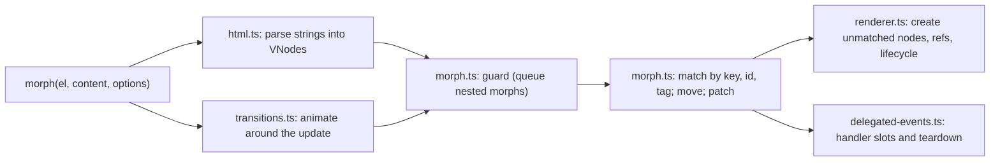

# Architecture: defuss-morph

defuss-morph turns new content (an HTML string or VNodes) into DOM changes on an existing element, keeping every node that can be reused. It owns parsing, reconciliation, element creation, event handler bookkeeping, lifecycle hooks and transitions. It is not a component framework: it keeps no tree of its own between calls, schedules nothing, and has no state management. Usage is in [README.md](README.md).

## Why this design

**The live DOM is the previous state.** Each morph reads the target's current `childNodes` and matches the new children against them. The alternative, a virtual DOM, diffs against a tree kept from the last render, which is wrong as soon as other code, server-rendered HTML or the user (typing, ticking) changed the real DOM. Reading the DOM makes morph usable on markup it did not create and next to other libraries.

**Moving beats recreating.** Replacing children (`innerHTML`) destroys focus, selection, typed input, scroll position and listeners. The website's playground runs both engines on identical markup and counts the DOM mutations; `make e2e` asserts there that a note typed into a keyed list item survives a reorder with morph and is lost with innerHTML (`scripts/e2e/browser.mjs`).

**Absent means "leave it alone".** HTML cannot express "unchecked" or "no handler", so attributes an HTML string omits on form controls, and handlers it cannot declare, are kept rather than removed. VNodes can express these values and are the way to set them. The same reading makes diff mode possible: a change-set mentions only what changes.

**Handlers listen on their element.** JSX handlers install one trampoline listener per element, event and phase that calls whichever handler the slot holds. The alternative, one delegating listener at the document, has to replay the event path itself and gets propagation wrong: order relative to native listeners, an ancestor's `stopPropagation()`, non-bubbling events and `currentTarget`. On the element, the browser applies every rule; `src/delegated-events.browser.test.ts` checks each of these cases in Chromium.

**Fragments parse as template content.** Inside `<body>`, the HTML parser drops `<tr>`, `<td>` and other context-dependent tags and moves a leading comment out of the body; a `<template>` element's content keeps both and stays inert (`src/html.test.ts` and `src/morph-diff.test.ts`, in happy-dom and Chromium).

## How it works

- `src/index.ts` exports `morph()`. It resolves the element's own window, parses strings with that window's `DOMParser`, and runs the update directly or inside a transition. A per-element content slot makes overlapping transitions apply the latest requested content.
- `src/html.ts` converts markup into VNodes. Full documents (starting with a doctype, `<html>`, `<head>` or `<body>`) are parsed as documents; fragments are parsed as `<template>` content. VNodes read from the DOM carry a marker so the reconciler preserves handlers that HTML cannot declare.
- `src/morph.ts` holds the reconciler. `updateDomWithVdom` marks the target as rendering; a morph on the same element or a descendant during that time is queued (latest wins) and replayed afterwards. `morphDomDirect` normalizes the children (flattens fragments, joins adjacent text), builds a key pool (`key` attribute or stored key, then `id`) and an unkeyed pool, then walks the new children once: take a keyed match or the first unkeyed node with the same tag, move it into place with `insertBefore`, patch it, recurse; otherwise create. Unclaimed nodes are removed after their handlers are torn down. Diff mode (`morphDiff`) only patches addressed nodes with merged attributes and appends new ones.
- `src/renderer.ts` creates DOM from VNodes (SVG namespace, text and comment nodes, attributes, refs) and runs lifecycle hooks: `onMount` once after insertion, and one `MutationObserver` per element with `onUnmount`, which calls the handler of the latest render when the element leaves the document.
- `src/delegated-events.ts` keeps handlers in `WeakMap`s keyed by element. `onClearDelegatedEvents` hooks let other libraries (defuss-query) release their own listeners whenever morph removes or replaces an element.
- `src/global.ts` and `src/all.ts` exist only for the CDN bundle: evaluating `dist/all.js` assigns the API to `globalThis.df$`, keeping an existing `df$` object or function. The package entries (`src/index.ts`, built to `dist/index.mjs` and `dist/index.cjs`) have no side effects.

Builds: pkgroll compiles `src/index.ts` to ESM, CommonJS and declarations; `scripts/bundle.ts` (Bun) bundles `src/all.ts` into the self-contained `dist/all.js`; `scripts/minify.ts` (oxc-minify) writes `dist/all.min.js`. `scripts/stats.ts` measures them, `scripts/docs.ts` copies the built files into the website, rewrites its size figures, highlights its code examples with Shiki (static colored markup) and bundles Shiki for the playground's editor (`docs/assets/shiki.js`, the same release and theme), and `scripts/check-dist.ts` fails the build while any of these drift.

## Operations

- **Deployment and scaling:** published to npm; jsDelivr serves `dist/` from npm and from GitHub (so `dist/` is committed). `docs/` is a static site for GitHub Pages (`docs/CNAME`: morph.defuss.org) that loads defuss-shadcn 0.9.11 from jsDelivr, pinned by Subresource Integrity. Its playground loads `docs/assets/shiki.js` (97 kB gzipped) from the site itself once it comes near the viewport, so edited code is colored too.
- **Complexity and resources:** one morph visits every new child once. A keyed child is matched through a `Map` lookup; an unkeyed child scans the unkeyed pool from its start, so long unkeyed sibling lists cost up to quadratic time in their length. Keys keep matching constant per child. Each element with an `onUnmount` hook holds one `MutationObserver` on its parent until it is removed.
- **Observability:** the library does not log (`.vae/VERIFY.py` rule `src.no-console`). Failures are thrown to the caller: diff mode throws an `Error` for items without `key` or `id`, and DOM exceptions from invalid input propagate unchanged.

## Security and privacy

Attack surface: the content passed to `morph()`. It is rendered, not sanitized. Elements are created with `document.createElement`, so a `<script>` in an HTML string runs when morphed in, unlike with `innerHTML` (verified in Chromium); attributes such as `onclick` and `dangerouslySetInnerHTML` are applied as given. Treat input like code: never morph untrusted HTML without sanitizing it first. Parsing itself happens in a detached document or template, where nothing executes or loads. The package reads no configuration, no environment variables and no secrets, and makes no network requests.

Privacy: the library processes no personal data. The website loads stylesheets and scripts from jsDelivr, which receives the visitor's IP address and user agent with each request; it sets no cookies and stores only the chosen colour theme in `localStorage`.
