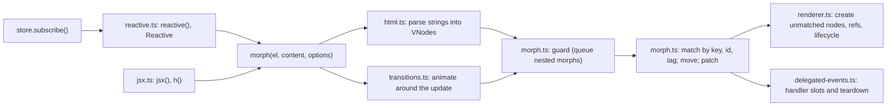

# Architecture: defuss-morph

defuss-morph turns new content (an HTML string or VNodes) into DOM changes on an existing element, keeping every node that can be reused. It owns parsing, reconciliation, element creation, event handler bookkeeping, lifecycle hooks and transitions, plus a thin layer on top: a JSX runtime, refs and store-driven re-rendering (`reactive()`, `<Reactive>`). It is not a component framework: it keeps no tree of its own between calls, has no hooks and no store of its own; stores come from outside (defuss-store or anything with `subscribe()`). Usage is in [README.md](README.md).

## Why this design

**The live DOM is the previous state.** Each morph reads the target's current `childNodes` and matches the new children against them. The alternative, a virtual DOM, diffs against a tree kept from the last render, which is wrong as soon as other code, server-rendered HTML or the user (typing, ticking) changed the real DOM. Reading the DOM makes morph usable on markup it did not create and next to other libraries.

**Moving beats recreating.** Replacing children (`innerHTML`) destroys focus, selection, typed input, scroll position and listeners. The website's playground runs both engines on identical markup and counts the DOM mutations; `make e2e` asserts there that a note typed into a keyed list item survives a reorder with morph and is lost with innerHTML (`scripts/e2e/browser.mjs`).

**Moves are atomic where the platform allows.** `insertBefore()` removes a node before inserting it, and the removal blurs a focused input inside it; in the playground, every reorder that moved the item being typed in lost focus. `moveBefore()` moves without removal and keeps focus, the caret and other live state, so morph uses it and falls back to `insertBefore()` plus a focus and selection restore elsewhere. VERIFIED: `src/morph.browser.test.ts` moves a focused input with a selection in Chromium on both paths.

**Only nodes out of order move.** Morph first matches every new child, then keeps the longest run of matched nodes whose old order already fits the new one where it is (`src/lis.ts`, O(n log n)) and moves each other match before the next node that stays. The earlier placement moved every match that was not at the next position, so one node out of place shifted every node after it. VERIFIED (MutationObserver, Chromium, 1,000 keyed rows, 2026-11-01): swapping rows 2 and 999 moved 997 rows before and moves 2 now; removing one row moved 500 and moves none. The placement change left matching as it was: `src/morph-reorder.test.ts` checks the node every child reuses against a model of the matching rules, and the order, focus, selection, typed values, listeners and lifecycle hooks across the everyday list operations; it passed against both placements.

**Absent means "leave it alone".** HTML cannot express "unchecked" or "no handler", so attributes an HTML string omits on form controls, and handlers it cannot declare, are kept rather than removed. VNodes can express these values and are the way to set them. The same reading makes diff mode possible: a change-set mentions only what changes.

**Handlers listen on their element.** JSX handlers install one trampoline listener per element, event and phase that calls whichever handler the slot holds. The alternative, one delegating listener at the document, has to replay the event path itself and gets propagation wrong: order relative to native listeners, an ancestor's `stopPropagation()`, non-bubbling events and `currentTarget`. On the element, the browser applies every rule; `src/delegated-events.browser.test.ts` checks each of these cases in Chromium.

**Re-render the whole region; let morph keep what stays.** `reactive()` calls `render()` and morphs the full result on every store change, instead of tracking which store field feeds which node (fine-grained signals). The morph already makes the full re-render keep focus, typed input and listeners, and a render function stays a plain function of the store. The cost is one reconciliation per change, proportional to the region; `computed()` selectors in defuss-store narrow when it runs. VERIFIED: `src/reactive.test.ts` and the website e2e type into a row, change the store, and find the same node with the typed value.

**Stores are a structural contract.** `reactive()` accepts any `{ subscribe(listener) }` returning an unsubscribe function or an object with `unsubscribe()`. Depending on defuss-store would add a runtime dependency to a zero-dependency package and exclude other store libraries; the tests drive the real defuss-store, `computed()` included, and an RxJS-shaped observable.

**`<Reactive>` renders its first content inline.** The component returns its wrapper with the first `render()` result as children, rather than an empty wrapper filled in `onMount`. A parent re-render then morphs content consistent with the store into the wrapper instead of clearing it until a queued render restores it, and the first paint has the content. The subscription starts in `onMount`, the first moment the element exists; morph runs `onMount` in a microtask and again after every in-place patch, so the handler keeps one subscription per element (a `WeakMap`), moves it to the latest render function, and renders once to catch a store change made before the microtask. VERIFIED: `src/reactive.test.ts` ("picks up a store change made before its mount callback ran", "a parent re-render keeps one subscription per wrapper").

**The JSX runtime is the package entry.** `defuss-morph/jsx-runtime` and `jsx-dev-runtime` map to `dist/index.*` in `package.json` `exports`. A separate pkgroll entry made rollup split the runtime into a shared chunk that `index.mjs` imported (VERIFIED: `dist/jsx-runtime-*.mjs`), which breaks the one-file copies the website and the ZIP download serve; one entry also guarantees one module instance, and with it one handler registry.

**`installReactive(df$)` is explicit.** defuss-query's selections share one prototype, `df$.fn`; adding `.reactive()` there needs the query function, which defuss-morph does not import. The CDN bundle installs it when it finds `df$.fn` at load time (defuss-query loaded first); in defuss-query's recommended order the query global does not exist yet, so the page calls `df$.installReactive(df$)`. VERIFIED: `src/global.browser.test.ts` loads both bundles in both orders.

**Fragments parse as template content.** Inside `<body>`, the HTML parser drops `<tr>`, `<td>` and other context-dependent tags and moves a leading comment out of the body; a `<template>` element's content keeps both and stays inert (`src/html.test.ts` and `src/morph-diff.test.ts`, in happy-dom and Chromium).

## How it works

- `src/index.ts` re-exports the modules below; `src/api.ts` holds `morph()`. It resolves the element's own window, parses strings with that window's `DOMParser`, and runs the update directly or inside a transition. A per-element content slot makes overlapping transitions apply the latest requested content.
- `src/html.ts` converts markup into VNodes. Full documents (starting with a doctype, `<html>`, `<head>` or `<body>`) are parsed as documents; fragments are parsed as `<template>` content, created by one inert document per `DOMParser` rather than a new document per call: VERIFIED (A/B in Chromium, 2026-11-01): a document per call made 500 small re-renders take about half again as long. An element's VNode type is its `localName`, the name the parser gave it, so camelCase SVG elements such as `linearGradient` and `clipPath` stay SVG elements; lowercasing `tagName` made them unknown elements until 2026-11-01 (VERIFIED: `src/morph.test.ts`). VNodes read from the DOM carry a marker so the reconciler preserves handlers that HTML cannot declare. A `<template>` element's children are read from, created in and patched in its `.content` fragment (`templateContent()`), where the parser puts them; until 0.3.0 morph read `childNodes`, so a morphed template arrived empty and defuss-i18n found no translations (VERIFIED: `src/morph-edge.test.ts`, `src/reactive.test.ts`).
- `src/morph.ts` holds the reconciler. `updateDomWithVdom` marks the target as rendering; a morph on the same element or a descendant during that time is queued (latest wins) and replayed afterwards. `morphDomDirect` normalizes the children (flattens fragments, joins adjacent text), builds a key pool (`key` attribute or stored key, then `id`) and an unkeyed pool, then matches every new child (a keyed match, or the first unkeyed node with the same tag), keeps the longest run of matches already in order in place and walks the children in order: a match out of order moves before the next node that stays, a child without a match is created there, and each node is patched (recursing into its children). A move uses `moveBefore()` where the platform has it, else `insertBefore()` followed by restoring focus and the text selection. Unclaimed nodes are removed after their handlers are torn down. Diff mode (`morphDiff`) only patches addressed nodes with merged attributes and appends new ones.
- `src/renderer.ts` creates DOM from VNodes (SVG namespace, text and comment nodes, attributes, refs) and runs lifecycle hooks: `onMount` in a microtask after insertion and after every in-place patch that sets one, and one `MutationObserver` per element with `onUnmount`, which calls the handler of the latest render with the element when it leaves the document.
- `src/jsx.ts` is the JSX runtime (`jsx`, `jsxs`, `jsxDEV`, `Fragment`, `h`): plain VNodes, function components called at once, a component's `key` moved onto the element it returns. `src/ref.ts` holds `createRef()`.
- `src/reactive.ts` holds `reactive()` (render, subscribe, dispose), the `<Reactive>` component and `installReactive()` for defuss-query.
- `src/delegated-events.ts` keeps handlers in `WeakMap`s keyed by element. `onClearDelegatedEvents` hooks let other libraries (defuss-query) release their own listeners whenever morph removes or replaces an element.
- `src/global.ts` and `src/all.ts` exist only for the CDN bundle: evaluating `dist/all.js` assigns the API to `globalThis.df$`, keeping an existing `df$` object or function. The package entries (`src/index.ts`, built to `dist/index.mjs` and `dist/index.cjs`) have no side effects.

The website (`docs/`) runs the patterns and integrations from `docs/demos/`, sources written as a user would write them, with the package imports by name. `scripts/lib/demos.ts` bundles them with Bun.build (JSX compiled for `jsxImportSource: "defuss-morph"`, package imports left bare), copies the published files of defuss-query, defuss-store, defuss-i18n and defuss-dom-router from `node_modules` (the versions `bun.lock` pins) into `docs/assets/vendor/`, writes the import map that resolves the names, and fills every `<pre data-src>` code block with the source it names. The page therefore shows the code it runs, and the import map gives every demo and defuss-query one copy of morph. The alternative, demo code typed into the page and packages loaded from a CDN, would let the shown code and the run code drift apart and make the demos depend on a third-party host.

The benchmark (`docs/demos/bench.ts`) times typical operations on a table of 1,000 or 10,000 rows, and 500 re-renders of a 10-row view (one morph per state, as a `reactive()` region does), with `innerHTML`, keyed and non-keyed full morphs, and diff mode. It runs in the frame `docs/bench.html`, which the website's Benchmark section drives (`bench-ui.ts`) and `make bench` opens in headless Chromium (`scripts/bench.mjs`), so both measure the same code. The frame keeps the table's style and layout work out of the website's large page; measuring in the page itself would add the page's size to every number. A run times the update plus the layout it forces, and builds the input beforehand, so the cells compare the four ways of updating the DOM, not string building. The median of several runs, taken operation by operation, keeps a slow phase of the machine from favouring one method. The website shows one recorded run, which `make bench` writes into the page (`scripts/lib/bench-page.ts`) with its date, machine, defuss-morph version and browser versions, next to the live benchmark; README.md and ARCH.md state no figures. VERIFIED: four runs on one machine differed by up to 28% in a cell (Chromium, 2026-11-01: `innerHTML` creating 1,000 rows took 11.7 to 15.0 ms), so a recorded figure describes that run only, and the note says so. `make bench` refuses to write the page when a run left a wrong table or logged an error. `make coverage` writes the coverage rings the same way (`scripts/coverage-page.ts`).

`skills/defuss-morph/` is an Agent Skill (SKILL.md plus references), installed through the Claude Code plugin manifests (`.claude-plugin/`), the Codex manifest (`.codex-plugin/`), the skills CLI, or read from the npm package. `scripts/lib/skill.test.ts` fails when a manifest's version differs from `package.json` or the skill imports a name the package does not export.

Builds: pkgroll compiles `src/index.ts` to ESM, CommonJS and declarations; `scripts/bundle.ts` (Bun) bundles `src/all.ts` into the self-contained `dist/all.js`; `scripts/minify.ts` (oxc-minify) writes `dist/all.min.js`. `scripts/stats.ts` measures them, `scripts/docs.ts` copies the built files into the website, rewrites its size figures, highlights its code examples with Shiki (static colored markup) and bundles Shiki for the playground's editor (`docs/assets/shiki.js`, the same release and theme), and `scripts/check-dist.ts` fails the build while any of these drift.

## Operations

- **Deployment and scaling:** published to npm; jsDelivr serves `dist/` from npm and from GitHub (so `dist/` is committed). `docs/` is a static site for GitHub Pages (`docs/CNAME`: morph.defuss.org) that loads defuss-shadcn 0.9.11 from jsDelivr, pinned by Subresource Integrity. Its playground loads `docs/assets/shiki.js` (97 kB gzipped) from the site itself once it comes near the viewport, so edited code is colored too. The demos (`docs/assets/demos.js`, `router-demo.js` in the router frame `docs/router.html`, `bench.js` in the benchmark frame `docs/bench.html`) and the packages they import load from the site as well. The frames follow the page's colour theme through `docs/assets/frame-theme.js`, which mirrors the page's `dark` class: VERIFIED (Chrome, 2026-11-01): a frame that judged the theme from `prefers-color-scheme` stayed light in a dark page after loading inside a hidden tab panel.
- **Complexity and resources:** one morph visits every new child twice: once to match it, once to place and patch it. When the children line up one to one with the existing ones (as many, nothing keyed on either side, the same kind and tag at each position), the matching would pair them by position, so morph patches them in order without building its pools (`patchByPosition`): VERIFIED (A/B in Chromium, 2026-11-01): VNode select and swap on 1,000 rows took about a fifth less time, and `src/morph-reorder.test.ts` checks the reused nodes against the matching model for same-length lists. A `reactive()` region runs `render()` and one morph per store notification; each mounted `<Reactive>` holds one subscription per store, released when its wrapper leaves the document. A keyed child is matched through a `Map` lookup; an unkeyed child scans the unkeyed pool from its start, so long unkeyed sibling lists cost up to quadratic time in their length. Keys keep matching constant per child. Placement moves only the matches outside the longest run already in order, the fewest moves that restore the order. VERIFIED (interleaved A/B of both placements in one Chromium page, 2026-11-01): the keyed swap and removal of the benchmark took less than two thirds of their earlier time; the other operations, keyed and non-keyed, stayed within run-to-run noise. Each element with an `onUnmount` hook holds one `MutationObserver` on its parent until it is removed.
- **Observability:** the library does not log (`.vae/VERIFY.py` rule `src.no-console`). Failures are thrown to the caller: diff mode throws an `Error` for items without `key` or `id`, and DOM exceptions from invalid input propagate unchanged.

## Security and privacy

Attack surface: the content passed to `morph()`. It is rendered, not sanitized. Elements are created with `document.createElement`, so a `<script>` in an HTML string runs when morphed in, unlike with `innerHTML` (verified in Chromium); attributes such as `onclick` and `dangerouslySetInnerHTML` are applied as given. Treat input like code: never morph untrusted HTML without sanitizing it first. Parsing itself happens in a detached document or template, where nothing executes or loads. The package reads no configuration, no environment variables and no secrets, and makes no network requests.

Privacy: the library processes no personal data. The website loads stylesheets and scripts from jsDelivr, which receives the visitor's IP address and user agent with each request; it sets no cookies and stores only the chosen colour theme in `localStorage`, which the demo frames read when opened on their own. The benchmark sends its results nowhere; they stay in the page. The demos keep their state in memory only.
